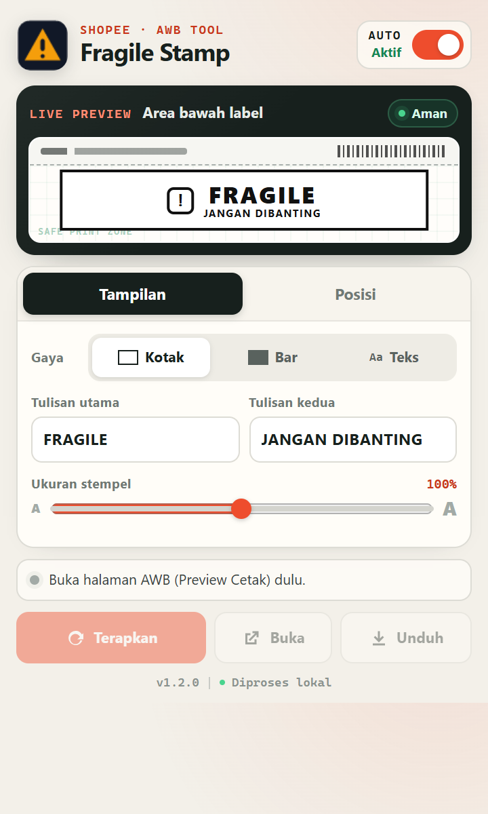
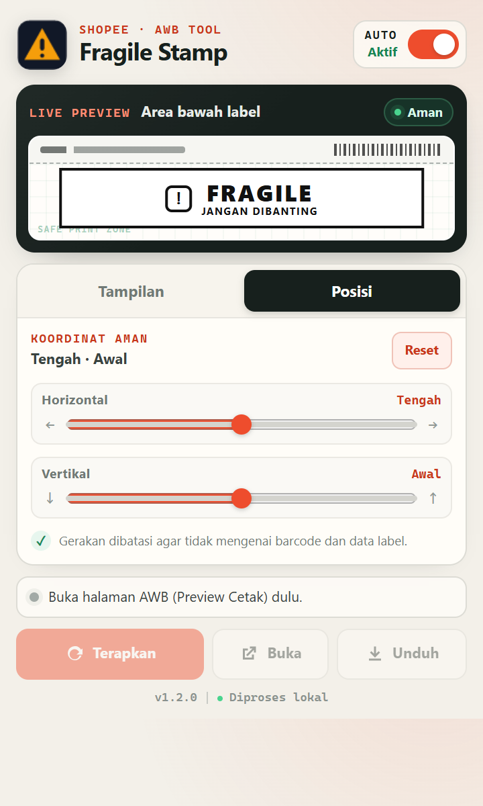

# Shopee AWB Fragile Stamp

[](https://github.com/mzainulirfan/awb-fragile-stamp/releases/latest)


Ekstensi Brave/Chromium (Manifest V3) yang **otomatis menambahkan stempel
FRAGILE / JANGAN DIBANTING** pada label AWB di Seller Centre Shopee
(`https://seller.shopee.co.id/awbprint...`).

Stempel ditulis langsung ke **file PDF label**, bukan sekadar overlay di layar.
Artinya tampilan preview, tombol unduh PDF, dan hasil cetak ikut membawa
stempel — tanpa mengganggu barcode, QR, maupun area sortir.

---

## Preview

| Tampilan | Posisi |
|---|---|
|  |  |

---

## 1. Pasang di Brave

1. Unduh ZIP terbaru dari halaman [Releases](https://github.com/mzainulirfan/awb-fragile-stamp/releases/latest).
2. Ekstrak ZIP ke folder permanen.
3. Buka `brave://extensions`.
4. Aktifkan **Developer mode** (kanan atas).
5. Klik **Load unpacked**, lalu pilih folder yang berisi `manifest.json`.
6. Buka halaman AWB seperti biasa. Stempel muncul otomatis dalam ±0,5 detik.

Tidak perlu build, tidak perlu npm. Semua dependensi (`pdf-lib`) sudah
dibundel di `lib/`.

---

## 2. Yang terlihat di halaman

- Label di dalam preview langsung berubah: ada kotak stempel di area kosong
  bawah label (di bawah baris `Pesan:`), tanpa menutupi data lain.
- Toast kecil di kiri bawah: **FRAGILE aktif**, dengan tombol **Buka** dan
  **Unduh** untuk versi PDF yang sudah distempel.
- Ikon ekstensi menampilkan badge **OK** (hijau) atau **!** (merah) bila gagal.

---

## 3. Pengaturan (klik ikon ekstensi)

Popup menggunakan tiga tab. **Tampilan** berisi preset, ikon, gaya, teks, dan
ukuran; **Posisi** berisi profil label serta penggeser horizontal/vertikal;
**Halaman** menentukan halaman PDF batch yang akan diberi stempel. Live preview
di bagian atas langsung mengikuti semua perubahan sebelum PDF ditulis ulang.

| Kontrol | Fungsi |
|---|---|
| Switch atas | Aktif/matikan stempel otomatis |
| Preset | Fragile, Jaga Tetap Kering, Sisi Ini ke Atas, atau Jangan Dilipat |
| Ikon handling | Gelas, payung, panah atas, larangan lipat, peringatan, atau tanpa ikon |
| Gaya: **Kotak / Bar / Teks** | Kotak = bingkai + ikon handling (paling hemat tinta), Bar = blok hitam penuh, Teks = teks tanpa bingkai |
| Tulisan utama | Default `FRAGILE` (maks. 18 karakter) |
| Tulisan kedua | Default `JANGAN DIBANTING` (maks. 24 karakter) |
| Ukuran | 60%–140% dari ukuran default |
| Posisi horizontal | Geser stempel ke kiri/kanan di dalam batas halaman |
| Posisi vertikal | Geser stempel ke bawah/atas di area kosong label |
| Profil label | Otomatis, A6, thermal 100 × 150 mm, A5, atau profil kustom |
| Reset posisi | Kembalikan ukuran dan posisi profil ke tata letak awal |
| Halaman PDF | Terapkan ke semua halaman atau pilih nomor halaman tertentu |
| Terapkan ulang | Memaksa stempel ditulis ulang pada tab AWB yang sedang aktif |
| Buka PDF / Unduh | Membuka / mengunduh PDF yang sudah distempel |

Semua pengaturan disimpan di `chrome.storage.sync`, jadi ikut tersinkron
antar perangkat bila sinkronisasi Brave aktif.

---

## 4. Cara kerja singkat

```
Halaman /awbprint
  └─ <iframe type="application/pdf" src="blob:...">
        │
        ├─ content.js  → ambil byte PDF
        │    1) GET /api/v3/logistics/download_sd_job?job_id=…&is_first_time=0
        │       (byte identik dengan blob yang tampil)
        │    2) fallback: fetch(blob URL) atau fetch via service worker
        │
        ├─ background.js → pdf-lib + lib/fragile-stamp.js menulis stempel
        │
        └─ content.js → URL.createObjectURL(hasil) → tukar src iframe
```

- Stempel digambar proporsional terhadap ukuran halaman, jadi tetap aman bila
  Shopee mengubah template A5/A6. Pada PDF multi-halaman, pengguna dapat
  menerapkannya ke semua halaman atau hanya nomor yang dipilih.
- Kontrol posisi memakai rentang `-100..100`, tetapi hasil akhirnya selalu
  dijepit ke margin halaman dan batas aman di bawah baris `Pesan:`.
- `MutationObserver` + interval ringan memastikan stempel dipasang ulang bila
  React membuat ulang iframe.
- `page-hook.js` (MAIN world) mengarahkan `window.open()` dan iframe/embed baru
  yang membuka **blob asli** ke blob hasil stempel, supaya jalur cetak Shopee
  tetap memakai PDF yang sudah distempel.

---

## 5. Batasan yang perlu diketahui

1. **Hanya halaman `/awbprint`** yang disentuh. Halaman lain tidak berubah.
2. **Tombol "Cetak Dokumen" milik Shopee**: handler-nya ada di komponen
   minified. Jika handler tersebut mengunduh ulang PDF lalu mencetak salinan
   mentah (bukan blob yang tampil), hasil cetak bisa tanpa stempel. Untuk
   hasil yang dijamin, pakai **Buka PDF** / **Unduh** dari ekstensi, lalu cetak
   dari tab PDF tersebut.
3. Stempel memakai font standar PDF (Helvetica). Karakter non-ASCII (emoji,
   aksara non-Latin) dinormalisasi atau diganti `?` — gunakan huruf Latin.
4. Ekstensi tidak mengubah data pesanan dan tidak mengirim apa pun ke server
   selain permintaan PDF ke domain Shopee sendiri.
5. Label yang isinya sangat padat (mis. multi-pesanan) tetap perlu diperiksa
   secara visual. Kontrol posisi dibatasi ke area bawah dengan jarak aman dari
   batas konten hasil analisis template AWB.

---

## 6. Privasi

Semua proses berjalan lokal di browser. Byte PDF hanya hidup di memori
(content script → service worker → blob baru) dan tidak pernah diunggah.
Tidak ada analytics, tidak ada fetch ke domain pihak ketiga.

---

## 7. Struktur berkas

```text
awb-fragile-stamp/
├── manifest.json          MV3, content script + MAIN-world hook
├── background.js          service worker: stempel PDF + badge status
├── content.js             deteksi halaman, ambil PDF, tukar iframe, toast
├── page-hook.js           MAIN world: redirect blob asli → blob stempel
├── popup.html/.css/.js    pengaturan & aksi
├── lib/
│   ├── pdf-lib.min.js     pdf-lib 1.17.1 (UMD, 525 KB)
│   └── fragile-stamp.js   penggambar stempel (badge/bar/text)
├── icons/                 ikon 16/32/48/128
├── docs/                  screenshot popup
└── make-icons.ps1         generator ikon (System.Drawing)
```

---

## 8. Uji cepat

1. Buka halaman AWB → label harus langsung menampilkan stempel.
2. Klik ikon ekstensi → status "Stempel aktif · sumber PDF: endpoint".
3. Ubah gaya ke **Bar** → label berubah tanpa reload.
4. Geser posisi horizontal/vertikal → label berubah tanpa reload dan tetap
   berada di area bawah.
5. Matikan switch → label kembali ke PDF asli.
6. Unduh PDF → buka di pembaca PDF, cari teks `FRAGILE` (harus ditemukan,
   karena stempel adalah text layer asli).

Jika stempel tidak muncul: buka DevTools Console dan cari `[AWB Fragile]`,
lalu klik **Terapkan ulang** di popup atau muat ulang halaman.

---

## Disclaimer

Proyek independen dan tidak berafiliasi dengan atau didukung oleh Shopee.
Nama dan merek dagang tetap menjadi milik pemiliknya masing-masing.
